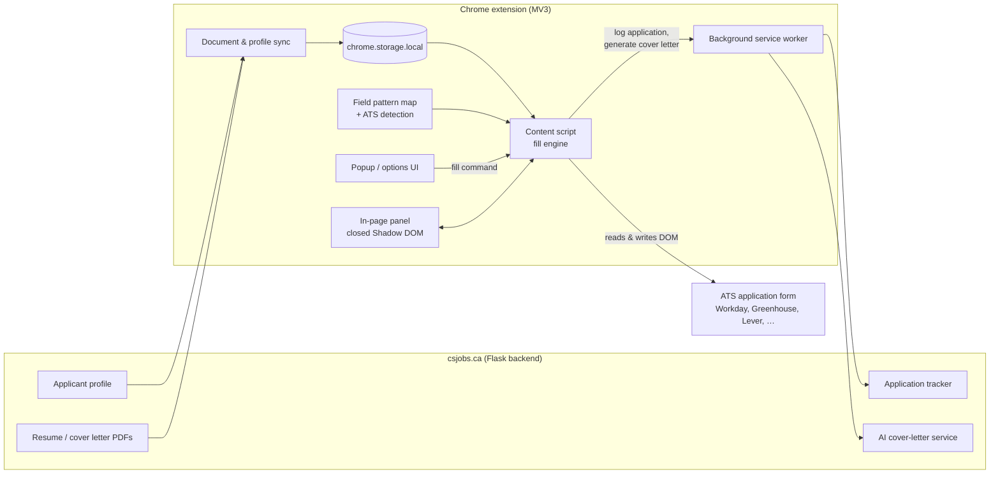

# csjobs.ca Autofill

**A Chrome extension that fills out job applications in one click, across 20+ applicant tracking systems.**

Built for [csjobs.ca](https://csjobs.ca), a job board for Canadian computer science students looking for internships, co-ops and new-grad roles. Students apply to dozens of postings per term, and every one of them asks for the same name, school, work history and resume on a slightly different form. This extension takes the profile a student already keeps on csjobs.ca and types it into whatever form is in front of them.

> **About this repository:** the extension is part of a private, commercial codebase, so the source code isn't published here. This repo documents how the system is designed, the engineering problems it solves, and how it's tested. I'm happy to walk through the code in an interview.

---

## At a glance

| | |
|---|---|
| **Platform** | Chrome extension, Manifest V3 (service worker, content scripts, Shadow DOM UI) |
| **Language** | JavaScript (no framework, no build step), with a Python/Flask backend |
| **Size** | ~8,000 lines across the extension; 80+ profile field types mapped |
| **ATS coverage** | Workday, Greenhouse, Lever, Ashby, iCIMS, Taleo, Jobvite, SmartRecruiters, BambooHR, Workable, Rippling, Recruitee, Breezy, Dover, Pinpoint, JobScore, SuccessFactors, Avature and more, plus a generic fallback for unknown sites |
| **Testing** | jsdom test suite against synthetic ATS fixtures, plus live checks on 17 real postings in headless Chromium |

---

## What it does

- **One-click fill:** detects the application form, matches each field to the user's profile, and fills it in.
- **Handles the hard fields:** native dropdowns, React-based searchable comboboxes, radio/checkbox questions, split month/year dates, and phone country-code pickers.
- **Multi-entry sections:** clicks "+ Add" to create extra education, work experience and language rows, then fills each row with the right entry.
- **Attaches documents:** puts the user's resume and cover letter PDFs straight into upload fields. It only reports a file as attached once the site's own UI shows the filename.
- **Cover letters:** fills cover-letter fields from a template with the company and role substituted in, or generates a tailored one with csjobs.ca's AI assistant.
- **"Needs your answer" card:** lists the questions it deliberately left for the applicant, with one-tap answer chips. Answers can be saved per site.
- **Application tracking:** logs the job to the user's csjobs.ca tracker as *Applied*, but only after a confirmed submission, never just because the form was filled.
- **Assessment heads-up:** warns when a posting mentions an online assessment or a recorded video interview (HackerRank, CodeSignal, HireVue, …).

---

## Architecture

**Main pieces:**

1. **Sync layer:** uses the user's existing csjobs.ca session to pull their profile, resume and cover letter into extension storage. The profile re-syncs every few minutes so edits show up on forms quickly. PDFs re-download only when the active resume changes.
2. **ATS detection + field pattern map:** identifies which ATS is hosting the page and loads that ATS's field patterns. Each profile field (first name, school, graduation date, sponsorship, …) has generic patterns plus patterns specific to each ATS.
3. **Fill engine (content script):** finds the form's fields, builds a "context string" for each one, matches it to a profile field, and fills it with the right technique for that kind of widget.
4. **In-page panel:** a floating launcher and progress panel rendered inside a *closed* Shadow DOM, so the host page's CSS can't break it and its scripts can't read it.
5. **Background service worker:** makes the calls back to csjobs.ca (tracker logging, AI generation) that a content script running on a third-party ATS origin can't make directly.

More detail in [docs/ARCHITECTURE.md](docs/ARCHITECTURE.md).

---

## How field matching works

Most ATS forms don't label their fields consistently. "First name" might show up as `legalNameFirstName`, `first_name`, `applicant.firstname`, an `aria-label`, or just text in a nearby `
`. So the engine never trusts a single attribute:

1. **Build context:** for each input, it gathers the `name`, `id`, placeholder, `aria-label`, ATS-specific data attributes, the associated `<label>`, and nearby question text, then lowercases and normalizes all of it into one string.
2. **Match:** it checks that string against the current ATS's patterns first, then falls back to generic ones. Some rules exist to prevent false matches. For example, a bare "Name" field maps to *full name*, but "Company name" and "School name" don't.
3. **Choose a value:** for dropdowns, a shared option matcher tries an exact match, then partial containment, then province ↔ abbreviation (`Ontario` ↔ `ON`), then degree-level synonyms (`Bachelor of Computer Science` → `Bachelor's Degree`). Short answers like "No" or "ON" only match whole words.
4. **Fill like a human:** React and other framework forms ignore a plain `el.value = …`. The engine fires the input/change events those frameworks listen for. For searchable comboboxes, it opens the widget, types, waits for the options to render, and clicks the real option.

---

## Engineering challenges

A few of the problems that took the most work:

**React-select comboboxes look like text inputs but aren't.** Greenhouse's newer forms render Country/Location as `<input role="combobox">` with hidden "decoy" inputs used for HTML5 validation. Typing into the input looked fine but never registered as a selection, and the decoys were winning the field match. The fix routes combobox inputs to a dedicated pass that types, waits for the listbox, and clicks the matching option, and it filters out `aria-hidden` decoys entirely.

**An off-by-one bug in multi-entry sections.** With 2+ jobs on a profile, entry #1 was getting entry #2's company and dates. A standalone "Skills" field was grouped under *experience* for display purposes, so the engine counted it as an extra experience row and shifted every entry by one. The test suite caught it. The fix was to separate "fields that live inside a repeating entry" from "fields shown in the experience section".

**Third-party sites fight back in odd ways.** Lever re-parses the uploaded resume and silently wipes fields without firing change events. Recruitee pre-sets a "+31" phone prefix. Some forms nest question labels four DOM levels up from the input. Others hide country-specific consent checkboxes or put login fields on the same page. Each one was found on a live posting and turned into a regression check.

**Many frames, many contexts.** Embedded application forms (e.g. Databricks on Greenhouse) run inside iframes, and each frame has its own isolated console. Debug output written to the console was easy to lose, so diagnostics go to extension storage, which every frame shares, and they show up in a Diagnostics panel on the options page.

**Extension updates break open tabs.** When the extension reloads, tabs that are already open keep running scripts whose Chrome APIs now throw. Every storage call goes through safe wrappers that check whether the extension context is still valid and fail quietly instead of crashing the page.

**Knowing an application was really submitted.** Filling a form doesn't mean the person applied. The tracker only logs *Applied* after a Submit click followed by either thank-you text or the form disappearing. That state is carried across page navigation so multi-step applications still count. On the backend, apply-step URLs (Workday `/apply/...`, locale prefixes, query params, requisition IDs) are mapped back to the original posting.

**Chrome Web Store compliance.** Some widgets only accept "trusted" (real user) input events. Forcing them would need the `debugger` permission, which is a red flag in store review. Instead, the extension leaves those fields for the applicant and lists them in the "Needs your answer" card.

---

## Design decisions about what *not* to fill

An autofill tool that guesses wrong on a job application can do real damage, so some choices were deliberate:

- **No guessing on factual or legal questions.** Citizenship, work authorization, sponsorship, licences and consent only ever come from the user's saved profile or from the user directly. Smart defaults never answer them.
- **No EEO / voluntary self-identification.** Gender, ethnicity, disability and veteran status are never collected or filled. That's a product decision about sensitive data, not a coverage gap.
- **Free-text "anything else?" boxes are left alone** instead of being stuffed with resume text.
- **Honeypot fields are skipped.**
- **Uploads are verified, not assumed.** Document status reads *attached* only when the site confirms it. Otherwise the user sees a clear "Missing" or "Upload" badge.

---

## Testing & verification

**Automated (jsdom):** a test runner loads the real extension scripts into jsdom against synthetic Greenhouse, Lever, Workday, Ashby and screening-question fixtures. It sends the same messages the popup sends and asserts on the results: personal info, addresses (including province abbreviations), single and multi-entry education and experience, degree dropdowns, ARIA comboboxes, languages, cover-letter templating, and missing-document badges.

**Live verification:** the packaged extension was loaded into headless Chromium with a synthetic "Jane Doe" profile and PDF (never a real resume) and run against 17 real postings:

| ATS | Example employers | Fields filled | Resume |
|---|---|---|---|
| Greenhouse | Cloudflare, mthree, Databricks (iframe embed) | 10–21 | attached |
| Lever | Spotify, Magnet Forensics | 10–11 | attached |
| Ashby | Notion, Quora, Cohere, Ramp | 5–7 | attached |
| BambooHR | Forsite, Arcadion | 11–12 | attached |
| Workable | Hugging Face | 9 | attached |
| Recruitee | Channable | 6 | attached |
| Rippling | Power TakeOff | 7 | attached |
| Avature | EA (2-step form) | 43 | attached |

Every bug found in a live pass was fixed and added to a regression fixture. A per-ATS coverage matrix tracks each field category as *Working*, *Partial* or *Untested*, so gaps are written down instead of assumed away.

**Production monitoring:** every fill records how many fields were filled, matched and left unmatched. Those numbers show up in a Diagnostics panel, which makes it easy to spot when an ATS changes its markup.

---

## Tech stack

- **Extension:** JavaScript, Chrome Extensions Manifest V3 (service worker, content scripts, `chrome.storage`, `chrome.scripting`, optional host permissions), Shadow DOM, DOM event simulation, `DataTransfer` file injection
- **Backend:** Python, Flask, SQLite, OpenAI API (cover-letter generation), resume parsing (pdfplumber / python-docx)
- **Testing:** Node.js + jsdom, headless Chromium for live verification

---

## Author

Built by **Mazen Talsam** as part of [csjobs.ca](https://csjobs.ca).
