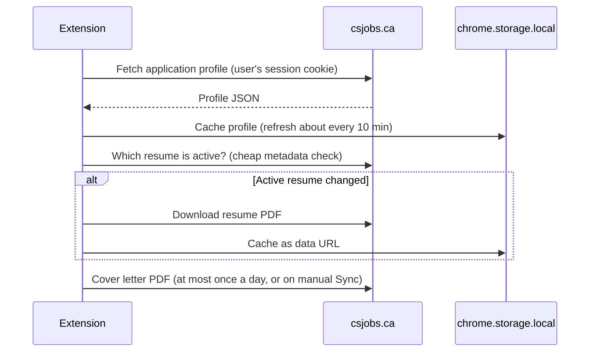
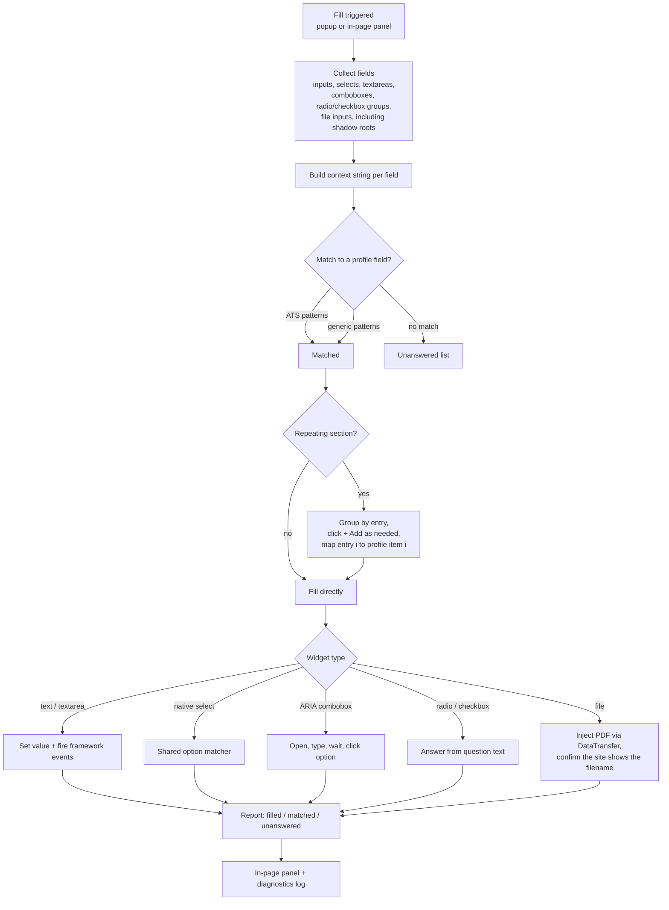
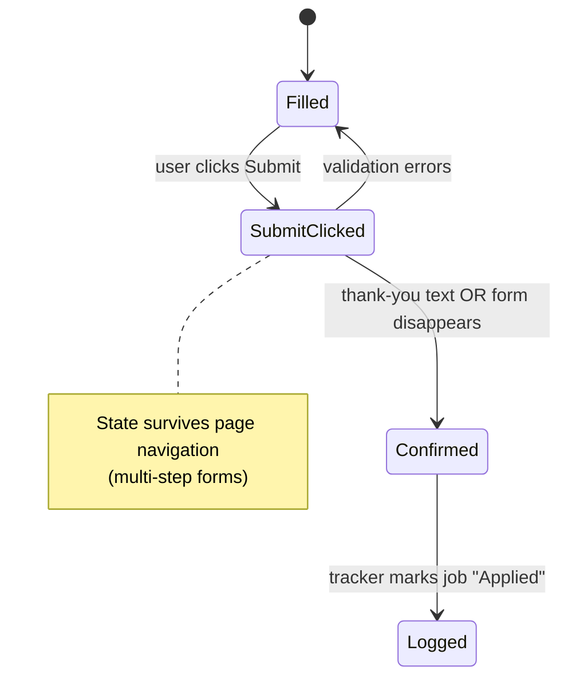

# Architecture

This is a deeper look at how csjobs.ca Autofill is put together. It describes the design only. The source code is private.

---

## Components

### 1. Manifest & permissions

- **Manifest V3**, with a background **service worker** instead of a persistent background page.
- **Host permissions** cover only csjobs.ca and the known ATS domains (Workday, Greenhouse, Lever, Ashby, iCIMS, Taleo, …). The extension doesn't ask for access to every website by default.
- **"Autofill on every site"** is opt-in. It uses an *optional* host permission that the user grants from the popup. In that mode, a small loader script runs first, and the fill engine stays hidden until it finds a real application form, so it doesn't show up on ordinary web pages.
- **No `debugger` permission.** It was removed so the extension can pass Chrome Web Store review. Widgets that only accept trusted input are left for the user.

### 2. Sync layer

- Uses the session the user already has on csjobs.ca, so there's no separate login or API key.
- The expensive work (downloading PDFs and encoding them as base64) only happens when something has actually changed.

### 3. Profile cleanup (server side)

Most profiles start from an automatically parsed resume, and resume parsing gets some layouts wrong. A typical mistake: the next job's "Company, City, Province" line gets glued onto the previous job's last bullet point, which shifts titles into the company field and puts dates inside job titles. Before the profile reaches the extension, a cleanup pass repairs those specific patterns. Each rule only fires on the exact broken shape, so a profile the user typed by hand passes through unchanged.

### 4. ATS detection & field pattern map

- The hostname tells the extension which ATS it's on (`workday`, `greenhouse`, `lever`, … or `generic`).
- The **field pattern map** covers 80+ profile fields across personal info, address, education, experience, languages, links, work authorization, availability and screening questions. Each field lists:
  - **generic** patterns that work on any site (checked last), and
  - **ATS-specific** patterns, such as Workday's `data-automation-id` values, Greenhouse/Lever `name` attributes, or Taleo field IDs.
- **Section metadata** groups the fields: which ones belong inside a repeatable entry (one job, one degree), which section headings to look for, and which "+ Add" button labels create a new entry.

### 5. Fill engine

Notes on each stage:

- **Field collection** also looks inside open shadow roots, since some ATSs (SmartRecruiters, for example) build their forms from web components. Hidden decoys and honeypots are skipped.
- **Context strings** combine attributes, label text, and question text from the surrounding DOM. Some sites put the label several levels above the input.
- **Shared option matcher**, used by both native `<select>`s and custom comboboxes: exact → partial → province abbreviation → degree-level synonyms, with whole-word matching for short values.
- **Radio/checkbox questions** are answered by reading the *question*, not the option labels, so a "Yes/No" group only matches yes/no profile fields.
- **Framework compatibility:** values are set the way React/Vue-controlled inputs expect, and the input/change/blur events those frameworks listen for are fired afterward.

### 6. In-page panel

- Rendered in a **closed Shadow DOM**, which isolates it in both directions: the host page's CSS can't style it and the host page's scripts can't reach into it.
- Shows a launcher that shrinks to a small mark on pages with no form, live fill progress, the "Needs your answer" card (answer chips, plus an inline Save that remembers answers per site), and the status of each document.

### 7. Background service worker

A content script running on, say, `boards.greenhouse.io` can't make authenticated requests to csjobs.ca. The worker handles those calls on its behalf:

- **Job lookup by URL:** maps the current ATS page back to the stored posting, used for keyword match scoring and tracker logging.
- **Tracker logging:** fires only after a confirmed submission.
- **Cover-letter generation:** the in-page AI button sends its request through the worker.

### 8. Submission detection

---

## Reliability details

| Problem | Approach |
|---|---|
| Extension reloaded while tabs are open | All storage access goes through wrappers that check whether the extension context is still valid and fail quietly |
| Script injected twice (popup + manifest) | A global guard so the engine only initializes once per frame |
| Iframes each have their own console | Diagnostic traces go to shared extension storage, capped at a fixed length, and appear on the options page |
| ATS markup changes over time | Every fill logs filled / matched / unmatched counts so a drop in coverage is easy to see |
| Resume names in ALL CAPS | Converted to title case before filling |
| The site's resume parser overwrites fields after upload | Profile-backed values are re-applied after the site's own parsing finishes |

---

## Testing strategy

1. **Unit-level DOM tests (jsdom):** the real extension scripts run against synthetic HTML fixtures modelled on each major ATS, driven by the same messages the popup sends.
2. **Regression fixtures:** every bug found on a live site becomes a fixture check, for example the screening-questions fixture with 10 checks drawn from real failures.
3. **Live verification:** the packaged extension runs in headless Chromium against real public postings with a synthetic profile. The results go into a per-ATS coverage matrix, so nothing gets reported as working without being checked.
4. **Backend unit tests:** the profile-cleanup rules and the logic that merges cleaned data back into the profile have their own pytest suites.
